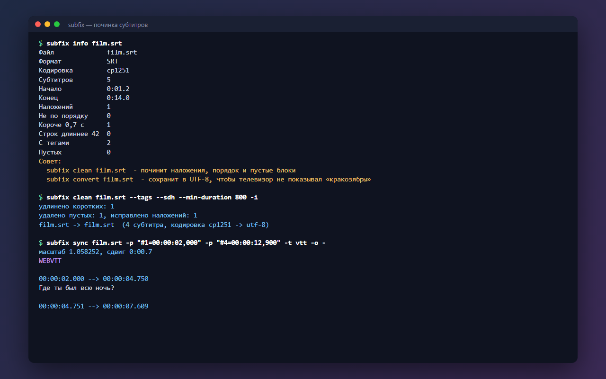

# subfix: починка субтитров из командной строки

Утилита на Python для тех, у кого субтитры «уехали»: опережают фильм, отстают к концу, показываются кракозябрами на телевизоре или налезают друг на друга. Сдвигает время, синхронизирует по двум опорным точкам, пересчитывает под другую частоту кадров, переводит Windows-1251 в UTF-8 и конвертирует SRT в WebVTT и обратно. Без зависимостей, только стандартная библиотека.



## Возможности

**Время**
- `shift`: сдвиг на `2.5`, `-1500ms`, `+00:00:03,000`; минус значит «раньше», время не уходит ниже нуля
- `shift --after 00:42:10`: сдвиг только второй половины, когда рассинхрон появился после рекламы или склейки
- `sync`: синхронизация по двум точкам. Если в начале субтитры отстают на секунду, а в конце на четыре, обычного сдвига мало: subfix сам вычисляет масштаб и смещение
- Точки задаются номером субтитра (`#12=00:01:05,300`) или временем (`00:01:02,000=00:01:05,300`); одна точка работает как обычный сдвиг
- `fps`: пересчёт между 23.976, 24, 25 и любой другой частотой кадров, когда субтитры от одного релиза, а видео от другого

**Кодировка и формат**
- Автоопределение UTF-8, UTF-8 с BOM, UTF-16, Windows-1251, KOI8-R и Windows-1252 по частоте русских букв
- Результат по умолчанию в UTF-8, `--out-encoding` для другой кодировки, `--crlf` для старых плееров
- `convert -t vtt`: SRT в WebVTT для HTML5-плееров и обратно; заголовки, `NOTE` и `STYLE` в VTT пропускаются, настройки позиции сохраняются

**Чистка**
- `clean`: сортировка по времени, удаление пустых блоков, обрезка наложений
- `--tags`: убирает `<i>`, `<font color>`, `{\an8}`
- `--sdh`: убирает пометки для слабослышащих: `[смех]`, `(дверь хлопает)`, `♪`, `ДЖОН:`
- `--min-duration 800`: удлиняет мелькающие субтитры, не залезая на следующий

**Проверка**
- `info`: формат, кодировка, длительность, число наложений, коротких и длинных строк, тегов, пустых блоков, подсказки, что починить

**Удобство**
- Можно передать сразу несколько файлов: `subfix convert *.srt`
- Исходник не трогается: результат пишется в `film.fixed.srt`; `-i` перезаписывает на месте, `-o -` выводит в консоль
- Понятные ошибки на русском с номером блока, код выхода 1 при ошибке

## Стек

Python 3.10+, argparse, dataclasses, codecs; pytest и GitHub Actions (Ubuntu и Windows, Python 3.10 и 3.13).

## Запуск

```bash
git clone https://github.com/whysafe/subfix.git
cd subfix
pip install .
subfix info examples/sample-cp1251.srt
```

Без установки: `python -m subfix ...` из папки проекта.

Примеры:

```bash
subfix shift film.srt --by -2.5s          # субтитры на 2,5 с раньше
subfix sync film.srt -p "#1=00:00:05,200" -p "#980=01:48:31,000"
subfix fps film.srt --from 23.976 --fps 25
subfix convert film.srt -t vtt -o film.vtt
subfix clean film.srt --tags --sdh -i
```

Тесты:

```bash
pip install -e ".[dev]"
pytest
```

## Структура проекта

```
subfix/
  timecode.py   # разбор и форматирование времени, сдвиги с единицами
  formats.py    # чтение и запись SRT и WebVTT
  encoding.py   # определение кодировки
  ops.py        # сдвиг, синхронизация, FPS, чистка, анализ
  cli.py        # команды и аргументы
examples/       # пример субтитров в Windows-1251
tests/          # pytest
```

## Как это устроено

- Всё время хранится в целых миллисекундах; синхронизация по двум точкам решает `t' = t * k + b`, где `k` и `b` подобраны так, чтобы обе точки встали точно на место
- Кодировка: BOM, затем строгая проверка UTF-8, затем текст декодируется как CP1251 и KOI8-R, и выигрывает вариант, где больше частых строчных русских букв; если русских букв мало, это Windows-1252
- Разбор терпим к реальным файлам: CRLF, BOM, отсутствующие номера блоков, лишние пустые строки, конец раньше начала
- argparse считает `-2s` флагом, поэтому отрицательные сдвиги перед разбором помечаются знаком минуса U+2212: `--by -2s` работает без `=`

## Идеи для развития

- Формат ASS/SSA
- Автоматическая синхронизация по звуковой дорожке
- Разбиение длинных строк по 42 символа

## Лицензия

MIT © 2026 whysafe. Telegram: [@yawhysafe](https://t.me/yawhysafe) · Сайт: [whysafe.ru](https://whysafe.ru)
